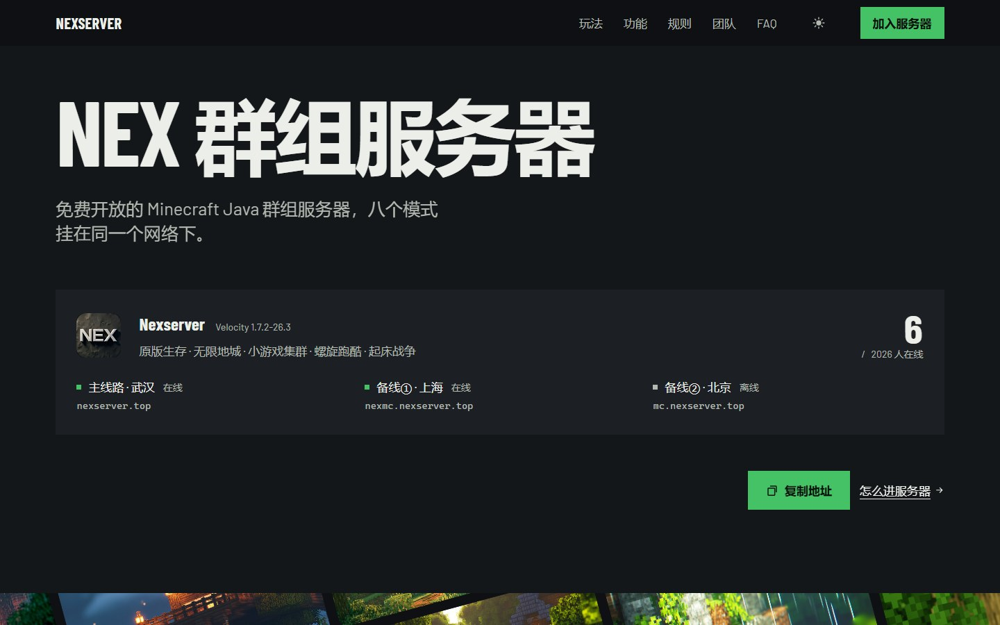
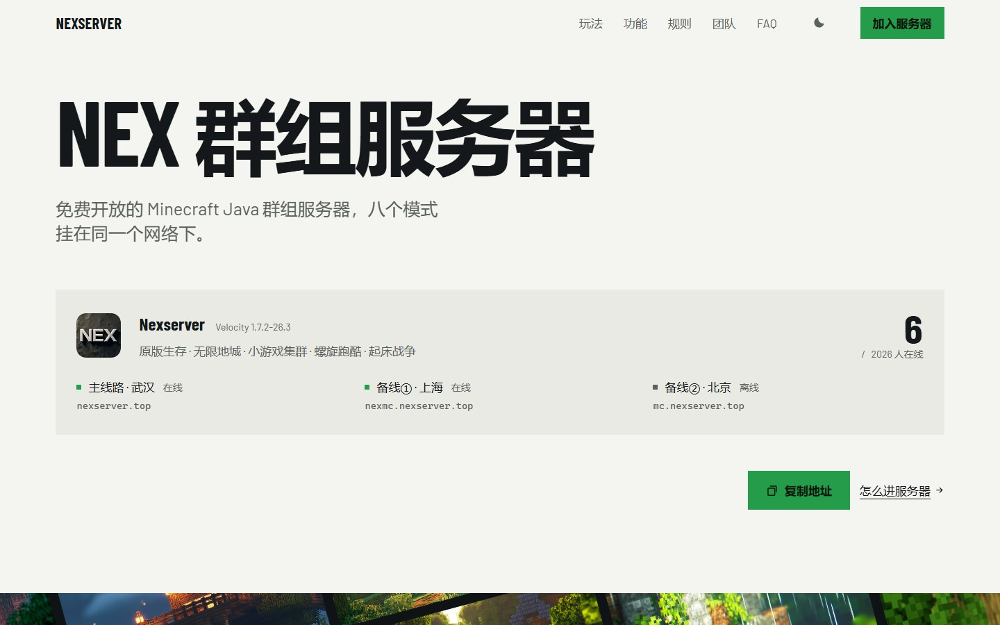
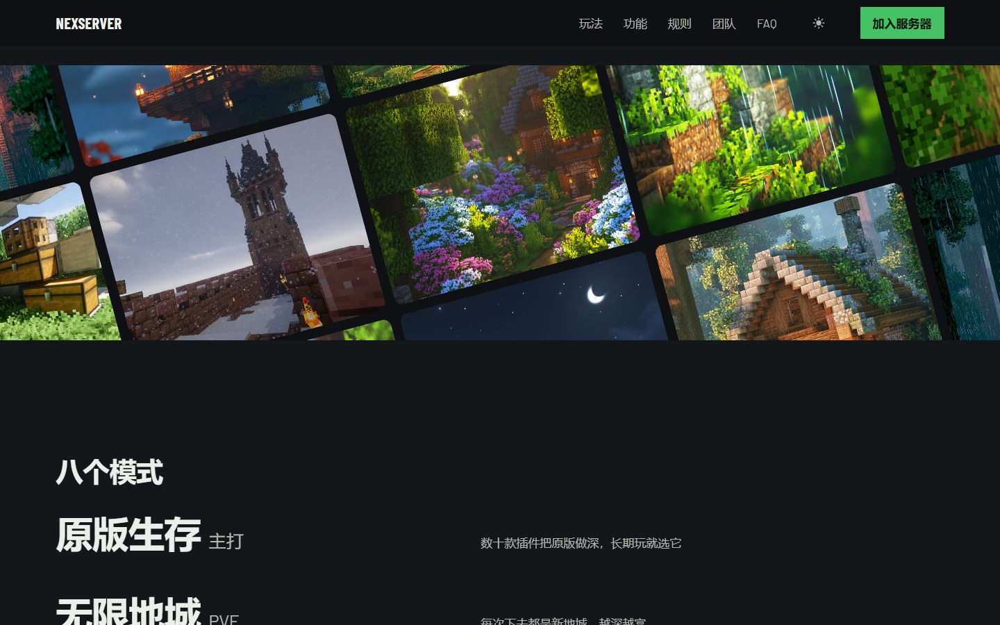
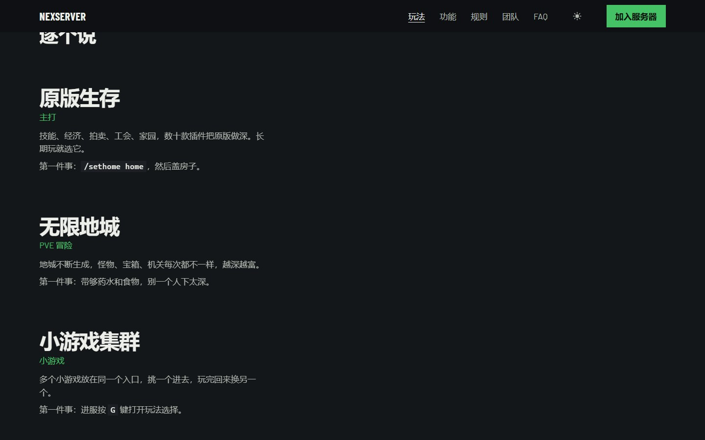

<h1 align="center">NEX Official Website</h1>

<p align="center">A Minecraft group server official website: pure static, zero dependencies, hand-written CSS/JS, with real online data, a mouse-following image wall, and light/dark theme switching.</p>

<p align="center">
  <a href="LICENSE"></a>
  
  
  
  
  <a href="https://www.nexserver.top"></a>
  
</p>

<p align="center">
  <a href="https://www.nexserver.top">Live preview</a> ·
  <a href="docs/shots">More screenshots</a> ·
  <a href="#local-development">Local development</a> ·
  <a href="#license">License</a>
</p>

<p align="center">
  
  
</p>

<p align="center">
  
  
</p>


## What this site does

- **The homepage stands on typography alone**: The first screen is a single large line of text, immediately followed by a "server list entry" — name, version, MOTD, player count, and three route statuses, all from real data via the Minecraft MOTD API.
- **The data is real**: Player counts come from public MOTD queries; host CPU / memory / instance count come from a self-hosted API. If it can't be read, it shows `—` — no made-up numbers.
- **The image wall follows the mouse**: `initGrid()` generates a 4×7 tilted grid; when the mouse moves, the four rows slide in opposite directions with different weights, and settle automatically on release. Only `transform` is used — no persistent animation.
- **Two color schemes**: A set of semantic color tokens, with `html.theme-light` overriding everything; the choice is stored in `localStorage`, and a script is injected before `</head>` to prevent a white flash.
- **Restrained motion**: A unified `cubic-bezier(.16,1,.3,1)`, 16px displacement, 0.85–1s duration; under `prefers-reduced-motion`, content appears immediately with no displacement.
- **No frameworks or icon libraries**: No Tailwind, no UI library, no Font Awesome — icons are inline SVG, fonts are self-hosted (Barlow / Barlow Condensed), and the first screen requires no third-party requests.

## Tech stack

| Item | Choice | Notes |
| --- | --- | --- |
| Pages | Hand-written HTML, assembled from partials | `build.mjs` inlines `partials/` into 9 templates |
| Styles | Hand-written CSS, ~900 lines | Semantic color tokens, a single grid, two corner-radius tiers |
| Scripts | Vanilla JS, ~13 KB | No build step, no bundler |
| Build | Single-file Node script | Only string concatenation and version hashing |
| Fonts | Self-hosted woff2 | Barlow Condensed + Barlow, with system sans-serif fallback for Chinese |

## Directory

```
src/                    Source files — this is the only place you need to edit
  *.html                9 page templates (with placeholders like <!--@nav-->)
  partials/             nav.html / footer.html / icons.html
  css/site.css          All styles and design tokens
  js/setting.js         Site config: addresses, routes, social links, homepage quotes
  js/site.js            Interactions: live data / image wall / copy / donation flow / Wiki sync
build.mjs               Assembly script: inline partials, add version hashes, output to root
重新发布.bat            Windows double-click build
css/ js/ *.html         Build output, directly servable as static files
docs/shots/             README screenshots
picture/ webfonts/      Images and self-hosted fonts
```

## Local development

```bash
node build.mjs            # Generate pages
npx serve .               # Or python -m http.server / any static server
```

You can also just double-click `index.html` — only `/api/*` requests will 404 and the page will show `—`, without throwing errors.

## Switching to your own server

1. **Config**: In `src/js/setting.js`, change the server address, route list, social links, and homepage random quotes.
2. **Copy**: Edit directly in `src/*.html`; navigation and footer are in `src/partials/` — change once and it applies site-wide.
3. **Colors**: The `:root` (dark) and `html.theme-light` (light) blocks at the top of `src/css/site.css`.
4. **Images**: Replace the same-named files under `picture/` — `cover-*.jpg` are covers, `gridmotion/g01..g18.jpg` are image wall assets, `avatar-*.jpg` are team avatars.
5. **Donation QR code**: Replace `picture/pay-*.jpg` with your own payment QR code (the repo contains placeholders).

## Data APIs

The page requests the following addresses; all can be replaced or removed entirely:

| Purpose | Address | Notes |
| --- | --- | --- |
| Player count | `motd.minebbs.com/api/status` | Public Minecraft MOTD query, one per route |
| Host data | `/api/host` | Self-hosted; returns fields like `cpu` `memPercent` `running` `total` `uptime` |
| Changelog | `/api/wiki-changelog` | Falls back to GitHub raw and a mirror, three levels |
| Payment verification | `/api/pay-turnstile-verify` | Disabled in the example, see the `initDonate` comments |

## Deployment

- **GitHub Pages**: The repo root is itself the build output — go to Settings → Pages and select the `main` branch root.
- **Your own server**: Drop the entire directory into nginx `root` as static files; use `proxy_pass` for `/api/*` to reverse-proxy to your own service.

## License

The code is released under the **GNU General Public License v3.0**, see [LICENSE](LICENSE). You are free to use, modify, and redistribute it; derivative works must also be open-sourced under GPL-3.0.

The text, game screenshots, and team avatars on the site belong to the NEX server — please do not copy them directly to other servers; contact the author first if you wish to use them.

Minecraft is a trademark of Mojang Studios; this project is not affiliated with it.
